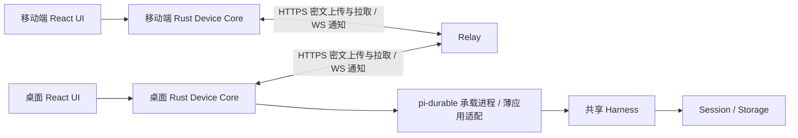

# AgentChat 架构总览

> **Status**: active（设计基线，尚未实现）。执行术语基于 pi-durable 1.2.0，多端职责参考 Lorca；Relay 部署和密码学协议仍为 proposed。

## 目标与范围

AgentChat 是支持多端聊天和工作管理的本机 Agent 工作台。桌面与 iOS/Android 客户端使用 React / Tauri，每台 Device 有 Rust Device Core；桌面 Device 另作为 Runner，由 Tauri 管理 pi-durable 的 TypeScript 承载进程。

各端主动连接独立 Relay，跨网络同步聊天和路由操作，无需同一局域网，也不开放桌面远程聊天服务器。首发只有一个桌面 Runner，所有 Bot 共用一个 Harness/Session；手机不运行 Harness，Relay 不运行 Agent。

产品范围见[蓝图](../PRODUCT_BLUEPRINT.md)，名称与含义以[术语表](../../GLOSSARY.md)为准。聊天与工作管理组织同一批 Conversation，工作目标保存在应用 Document 中；Task 专指库的持久化执行状态机。

## 核心原则

所有执行能力围绕 pi-durable 公开 API 构建。应用只负责 Bot、工作目标、界面、多端通信和平台装配，不自建 Agent loop、admission engine、执行队列、Task scheduler、检查点、执行 Commit 日志或通用恢复框架。

承载进程只初始化库并连接应用入口。普通聊天使用内置 Task；有实际持久化业务步骤需求时，才使用 Extension、Tool 或 defineTask。TaskRuntime 是库在 Task 阶段提供的调用接口，不是独立服务。

库未覆盖的能力先验证公开接口或上游支持，再调整范围，不使用私有接口或自建执行平台补齐。模块按真实消费者创建，不为未来需求预建框架。

## 系统结构



| 模块 | 职责 |
| --- | --- |
| React UI | Bot、Conversation、工作目标、Task 展示与设备状态 |
| Tauri 宿主 | 平台装配、系统能力、薄 IPC、安全存储；桌面管理承载进程 |
| Rust Device Core | 身份与配对、本地 Projection、网络 Outbox、Relay 同步和操作路由；手机不装配执行功能 |
| TypeScript 应用适配 | Bot 到 Agent 的配置、models/Registry/ExecutionEnv/Storage 装配、调用公开 API 和读取状态 |
| Harness | Commit、Entry、Document、Submission、内置 Task 调度与执行恢复 |
| Relay | 密文存储、定向投递、增量拉取、通知、设备在线状态和撤销 |

## 数据与行为边界

每个 Conversation 固定归属 Runner，其执行数据与应用 Document 由该 Runner 的 Harness 持有。其他 Device 保存展示 Projection 和未接纳的操作；不打开 Storage 副本恢复相同 Task，不另建 Message 或 Run 事实源。

Bot 是独立默认 Agent 配置档案。Conversation 创建时保存配置快照，已有 Conversation 仅在空闲时显式应用更新；归档 Bot 保留历史和恢复关联。Provider 凭据留在 Runner 安全存储。cwd 是默认目录，不提供文件系统隔离；不增加逐 Bot 工具审批体系。详细规则见[pi-durable 应用集成](01-pi-durable.md)。

Outbox 负责网络投递，pi.inbox 负责 Runner 接纳后的输入；Envelope 排队不等于 Submission。设备认证、签名、归属与请求校验仍属于应用边界，详见[多端与 Relay](02-multi-device.md)。

桌面关闭窗口进入退出路径，不维持托盘常驻。退出停止 Runner；Relay 和其他 Device 仍可同步与排队。重启使用 Harness 的恢复能力，并继续接收待投递请求。外部消息渠道、定时任务、主动推送、多 Runner 调度/迁移和独立常驻服务暂不纳入首发。

## 目标目录

以下是按应用职责组织的目标目录，随实际消费者逐步创建，不代表已有实现。

```text
src/                           React 界面、功能组合、共享 UI 与类型化 IPC
src-tauri/src/                 平台装配、薄 Command、Device Core 与安全存储
                               桌面另负责 pi-durable 承载进程生命周期

runner/                        TypeScript 薄应用适配
  entry.ts                     装配 models/Registry/Storage/Harness 与关闭
  bots.ts                      Bot Document 与 Agent 配置
  conversations.ts             公开操作与目标 Document
  transport.ts                 应用请求到公开 API 的薄适配

relay/                         必要的应用网络服务，技术实现待验证

docs/architecture/             当前设计
GLOSSARY.md                    统一词汇
```

React 经 Tauri IPC 访问应用能力；runner/ 直接使用 pi-durable 与 pi-ai 公开导出。Rust 只管理平台生命周期，不同时引入 Chord Host manager 或通用 Driver。移动端不打包 Node/Bun/Harness，不复制 Lorca 的 Expo/UniFFI/MyGo 技术栈。

不规划 admission/、scheduler/、checkpoints/、recovery/ 或执行 journal。状态订阅在实际调用处组合公开接口；职责增长后再拆分。运行数据留在平台应用数据目录，不提交数据库、生成产物或真实密钥。

## 文档导航与实现状态

- [pi-durable 应用集成](01-pi-durable.md)：公开 API、Bot 快照、Document 与执行 Storage、生命周期、扩展和执行验证。
- [多端与 Relay](02-multi-device.md)：设备信任、通信、离线投递、Projection、应用数据与网络验证。
- [runtime 研究记录](../research/pi-durable-runtime.md)：官方依据、本地存储冒烟结果及当时的应用建议。

仓库已安装 pi-durable，业务集成尚未实现。研究中的无模型存储冒烟仅验证了部分库契约，不代表模型/工具恢复、Tauri 打包、Relay 或手机链路已通过。

Node 官方 SQLite 路径优先验证，分发打包、移动端共享核心、Relay 部署和加密协议尚待落实。1.2.0 无通用 maxConcurrentRuns；总执行上限与完整多端状态对账不作已支持保证，具体缺口列在对应篇章。

pi-durable API 为实验性，实现以锁定版本文档和类型为准。当前设计替代 Pi CLI RPC、局域网直连和“宿主离线禁止输入”方案；deprecated 与 research 提供历史参考和研究依据，架构以当前三篇文档为准。

## 依据

- [pi-durable README](https://github.com/earendil-works/pi/blob/main/packages/durable/README.md)
- [pi-durable spec](https://github.com/earendil-works/pi/blob/main/packages/durable/docs/spec.md)
- Lorca 本地参考：docs/architecture/runtime.md、identity.md、phone-app.md、protocols.md、relay.md、relay-trust.md。

借鉴 Lorca 的 Device/Relay 分工，不复制其 Job 执行系统，也不将加密同步视为 pi-durable 内置能力。
