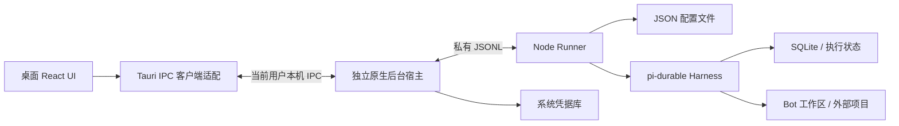

# AgentChat 架构总览

> **Status**: active。独立后台宿主、Node 24+ 初始化、配置文件已实现。macOS 已完成此前版本的后台和桌面临时目录冒烟。当前 Node 安装回退与 Windows named pipe IPC 尚未完成目标平台验收；Device Core 与 Relay 尚未实现。

## 分工与依赖

AgentChat 的桌面 UI 是后台 Runner 的客户端。Runner 是独立长期运行的单元，由原生宿主与 Node 进程组成；所有 Bot 共用一个 pi-durable Harness 和执行 Storage。桌面退出只释放自己的连接，执行生命周期不依赖 WebView。



| 部分                | 责任                                                         |
| ------------------- | ------------------------------------------------------------ |
| React UI            | 展示、编辑草稿、请求与客户端偏好；不访问执行数据库或明文凭据 |
| Tauri UI 宿主       | 平台装配、类型化 Command、连接或启动已有后台                 |
| 原生后台宿主        | 实例锁、本机 IPC、Node 生命周期、系统凭据；独立于 UI 存活    |
| Node Runner         | 配置管理、Harness 装配与应用操作、状态视图                   |
| Harness             | 输入接纳、Agent loop、Task 调度、持久化与恢复                |
| Device Core / Relay | 未来的设备身份、加密投递、同步与展示缓存，不执行 Agent       |

不自建 runtime、admission engine、scheduler、检查点或执行日志。TaskRuntime 是库的任务调用接口，不是后台服务。公开能力不足时先核对上游或调整范围，不依赖私有接口补出承诺。

产品聊天窗口可以汇集多个会话，不能因名称相同将它默认映射为一个库 Conversation。Bot 是可复用配置档案；界面组织不主导 Harness 的结构。[术语表](../../GLOSSARY.md)区分这两种对话概念。

## 当前源码职责

```text
src/
├─ App.tsx                     # 应用装配：Provider、路由与 IPC 客户端
├─ app/                        # 路由与布局组合、工作区状态、类型化 Tauri IPC
├─ features/bots/              # Bot 列表、详情、新建与配置表单
├─ features/chat/              # 连续对话与会话时间线
├─ features/settings/          # 设置分类与配置编辑
└─ components/ui/              # 共享基础组件
src-tauri/src/
├─ lib.rs                      # UI/后台入口分流、Tauri 装配
├─ commands/mod.rs             # 前端 IPC 边界
├─ host.rs                     # 独立后台宿主、生命周期与 Unix socket
├─ host/windows.rs             # Windows 命名管道、ACL 与帧传输
├─ runtime.rs                  # Node 检测、包管理器与校验下载
├─ runner.rs                   # Node 子进程、私有 JSONL 与反向凭据帧
└─ credentials.rs              # 系统凭据库、环境与受限凭据文件
runner/src/
├─ main.ts                     # 启动与关闭入口
├─ config/                     # schema、文件读写、有效值、重载和冲突
├─ providers/                  # 接入实例、模型覆盖、认证、测试与目录缓存
├─ harness/                    # 装配与公开操作、视图、extensions
└─ communication/              # 外部解析、路由、stdio 与 native 凭据桥
```

`config/` 回答期望配置是什么、哪些有效；不操作 Harness。`harness/` 直接组合 models、Registry、settings、ExecutionEnv 和 Storage，按公开 API 执行、观察工作。MCP adapter 在 Runner 生命周期内启动已配置的本机 stdio Server，并把发现的 Tool 注册到同一 Registry。`communication/` 将不可信外部输入转换为类型化操作，维护帧大小、关联与连接生命周期，不持有另一份执行状态。

模型、工作区、能力注册和状态投影都属于 Harness 装配或使用。Extension 相关 Tool、section 和持久状态集中在对应能力模块；不为未来子 Agent 或 Skill 建空框架。随包能力与 MCP 发现能力共用 Bot 显式选择的能力清单，新发现的 Tool 不会自动授予 Bot。当前 MCP 仅支持本机 stdio Server，不接远程或凭据型 Server；没有逐次工具调用审核，也不纳入计划模式。

根 React/Tauri package 与独立 `runner/` workspace 共用 `bun.lock`，Rust 继续由 Cargo 管理。Runner 采用 NodeNext 类型检查，构建产物只包含 `entry.js`，不携带 Node。原生检测器检查 `AGENTCHAT_NODE`、GUI 进程 PATH、平台常见位置和 AgentChat 私有 runtime，验证稳定 Node 24+、`node:sqlite`、版本、架构与绝对路径。首次启动找不到合格 Node 时尝试系统包管理器；失败后从 Node 官方发行源、再从 npmmirror 镜像下载到 AgentChat 数据目录，不修改用户 PATH。根命令聚合构建与测试，详见 [README](../../README.md)。

原生宿主将锁文件中已有的 `libc` 声明为 Unix 目标的直接依赖，用于独立进程会话、有效用户 ID 和非阻塞文件描述符等标准系统接口；Windows IPC 使用 Tokio named pipe，并为管道设置仅限当前所有者、SYSTEM 与管理员的 ACL。Node 发行包回退使用 `reqwest` 与 `sha2` 下载、校验和安装归档。没有新增需要随应用分发的 Node runtime；少量 `unsafe` 调用集中在 Unix 宿主与 Windows 安全描述符转换中，并以私有目录、实例锁和有界读写约束其使用。

## 平台打包与启动边界

基础 `tauri.conf.json` 的开发命令只启动前端，构建命令只检查并构建前端。桌面平台配置（macOS、Windows、Linux）分别追加 Runner 构建命令与 `runner/entry.js` 资源，保留桌面窗口行为。移动端沿用基础配置，不携带 Runner 资源；Rust 的后台宿主、Node 检测与 Runner Command 继续限定为 `cfg(desktop)`。

React 入口通过 Tauri OS 平台识别 Android / iOS，与窗口宽度无关。移动端不挂载桌面的 RuntimeGate、工作区 Provider 和路由，不调用本机 Runner IPC，也不绑定桌面拖拽与最大化事件。当前仅显示连接说明；后续移动数据访问应接入 Device Core / Relay，不能直接复用桌面的本机 IPC。

## 数据所有权与生命周期

期望配置的权威来源是 `runner.json` 与 `bots/<id>/bot.json`，执行数据库保存已确定的 Agent 配置和执行事实。UI 修改请求经 Runner 校验、检查版本并原子写文件；手工编辑在启动或显式重载时读取。默认模板只在创建 Bot 时具体化。配置格式、路径与生效规则见[集成设计](01-pi-durable.md#配置文件)。

默认数据根目录为 `~/.agentchat`，可用绝对路径 `AGENTCHAT_DATA_DIR` 覆盖，不做旧格式或目录迁移。工作区与配置、状态分开，同一 Bot 默认共享工作区，cwd 不提供隔离。密钥存储在系统安全设施，不写 JSON、工具环境或 Projection。

桌面 UI 启动先探测 Node 24+。合格时复用；缺失时 macOS 通过 Terminal 引导 Homebrew bootstrap（TUNA、USTC、官方源）并安装 Node，Windows 使用 winget（缺少 App Installer 时打开 Microsoft Store），Linux 仅当 apt 候选版本达到 24 时安装。包管理器失败或安装后仍不合格时，下载官方 Node 发行包，再回退到 npmmirror Node 镜像，安装在 `~/.agentchat/runtimes/node-v24`，不修改用户 PATH，也不替换已有系统 Node。运行时就绪后，UI 先连接已有 Runner，未运行再启动；Unix IPC 使用当前用户权限保护的 socket 和实例锁，Windows IPC 使用拒绝远程连接的命名管道，ACL 限制为当前所有者、SYSTEM 与管理员。后台停止调用 Harness.close 并收尾，保留恢复状态。

## 多端规划

未来 Device Core 维护设备身份、Projection、Outbox 和游标；各端主动连接独立 Relay，通过加密请求路由到指定 Runner。Device 是客户端身份，Runner 是后台执行宿主，两者不再是同义概念。后台宿主与 Device Core 的网络接入契约将在多端实现时确定。

Relay 不运行 Harness、不读取工作区或执行 Storage；手机不取得 Provider 密钥。Outbox 负责接纳前的投递，pi.inbox 负责已接纳输入。客户端缓存不能覆盖执行事实，详见[多端与 Relay](02-multi-device.md)。

## 验证边界与依据

本地测试分布在 `tests/`、`runner/tests/` 和 Rust 模块内，覆盖 UI、配置、Harness 操作和宿主协议。此前 macOS 版本已验证真实后台二进制的多客户端关联、单实例、配置重载、过期保存拒绝、显式停止和重开后的配置快照；桌面界面已验证配置读取、停止后台后 UI 保留，以及 UI 进程退出后后台存活和重新连接。未使用真实用户数据或调用真实模型。

前端与 Runner JavaScript 构建、macOS Rust 检查通过。当前桌面 Tauri 执行资源仅包含 `runner/entry.js`，不携带 Node；此前随包 Node 的 macOS release 冒烟属于历史验证。Node 下载索引与 checksum 路径已核实，但本次未执行下载、包管理器安装或新初始化流程的目标平台冒烟。Windows IPC（含 ACL 与停止状态处理）在隔离 Tokio harness 上通过 `x86_64-pc-windows-gnu` 编译；完整 Tauri Windows 交叉编译仍因缺少 MinGW 编译器未完成，Windows 运行验证仍缺。桌面界面结构及验证范围见 [UI 结构](03-ui-structure.md)。真实模型、工具中断的跨进程恢复和其他平台仍需专项验证。

移动端已分离打包与启动入口，仅展示连接说明页；多端通信、Relay、共享契约生成不列为已实现。库 API 为实验性，具体行为以锁定版本类型和源码为准。

- [产品蓝图](../PRODUCT_BLUEPRINT.md)
- [UI 结构](03-ui-structure.md)
- [pi-durable 应用集成](01-pi-durable.md)
- [多端与 Relay](02-multi-device.md)
- [runtime 研究记录](../research/pi-durable-runtime.md)：历史研究依据，不覆盖当前宿主设计
- [上游 README](https://github.com/earendil-works/pi/blob/main/packages/durable/README.md)
- [上游 spec](https://github.com/earendil-works/pi/blob/main/packages/durable/docs/spec.md)
