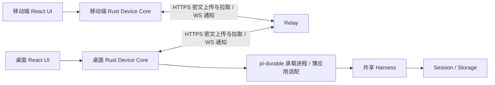

# AgentChat 架构总览

> **Status**: active（本机桌面切片已实现；多端与 Relay 仍是目标）。执行术语基于 pi-durable 1.2.0，多端职责参考 Lorca；Relay 部署和密码学协议仍为 proposed。

## 目标与范围

AgentChat 是支持多端聊天和工作管理的本机 Agent 工作台。桌面与 iOS/Android 客户端使用 React / Tauri，每台 Device 有 Rust Device Core；桌面 Device 另作为 Runner，由 Tauri 管理 pi-durable 的 TypeScript 承载进程。

各端主动连接独立 Relay，跨网络同步聊天和路由操作，无需同一局域网，也不开放桌面远程聊天服务器。首发只有一个桌面 Runner，所有 Bot 共用一个 Harness/Session；手机不运行 Harness，Relay 不运行 Agent。

产品范围见[蓝图](../PRODUCT_BLUEPRINT.md)，名称与含义以[术语表](../../GLOSSARY.md)为准。聊天与工作管理组织同一批 Conversation，工作目标保存在应用 Document 中；Task 专指库的持久化执行状态机。

## 核心原则

所有执行能力围绕 pi-durable 公开 API 构建。应用只负责 Bot、工作目标、界面、多端通信和平台装配，不自建 Agent loop、admission engine、执行队列、Task scheduler、检查点、执行 Commit 日志或通用恢复框架。

承载进程只初始化库并连接应用入口。普通聊天使用内置 Task；有实际持久化业务步骤需求时，才使用 Extension、Tool 或 defineTask。TaskRuntime 是库在 Task 阶段提供的调用接口，不是独立服务。

库未覆盖的能力先验证公开接口或上游支持，再调整范围，不使用私有接口或自建执行平台补齐。模块按真实消费者创建，不为未来需求预建框架。

## 系统结构

下图描述完整目标架构；当前已落地的部分是桌面 UI → Tauri 宿主 → Node Runner → pi-durable Harness/SQLite，手机、Device Core 与 Relay 尚未实现。



| 模块 | 职责 |
| --- | --- |
| React UI | 当前桌面 App 已实现 Bot、Conversation、工作目标、Task、凭据与 Runner 状态；手机 UI 尚未实现 |
| Tauri 宿主 | 桌面平台装配、系统能力、类型化 IPC、安全存储与 Runner 子进程管理 |
| Rust Device Core | [规划] 身份与配对、本地 Projection、网络 Outbox、Relay 同步和操作路由 |
| TypeScript 应用适配 | 当前 Runner 实现 Bot/Conversation 用例、models/Registry/ExecutionEnv/Storage/Harness 装配、公开 API 调用和状态 Projection |
| Harness | Commit、Entry、Document、Submission、内置 Task 调度与执行恢复 |
| Relay | [规划] 密文存储、定向投递、增量拉取、通知、设备在线状态和撤销 |

## 数据与行为边界

每个 Conversation 固定归属 Runner，其执行数据与应用 Document 由该 Runner 的 Harness 持有。其他 Device 保存展示 Projection 和未接纳的操作；不打开 Storage 副本恢复相同 Task，不另建 Message 或 Run 事实源。

Bot 是独立默认 Agent 配置档案。Conversation 创建时保存配置快照，已有 Conversation 仅在空闲时显式应用更新；归档 Bot 保留历史和恢复关联。Provider 凭据保存在系统凭据库，通过私有 Runner IPC 送入 Provider 认证闭包。cwd 是默认目录，不提供文件系统隔离；不增加逐 Bot 工具审批体系。详细规则见[pi-durable 应用集成](01-pi-durable.md)。

Outbox 负责网络投递，pi.inbox 负责 Runner 接纳后的输入；Envelope 排队不等于 Submission。设备认证、签名、归属与请求校验仍属于应用边界，详见[多端与 Relay](02-multi-device.md)。

目标行为是桌面关闭窗口后退出并停止 Runner，其他 Device 可继续通过 Relay 同步和排队；重启由 Harness 恢复未完成工作。当前桌面已实现 Runner 正常关闭及 Harness close/reopen/resume；Relay、多设备续传和 Tauri 应用进程重启中的运行任务尚未验证。外部消息渠道、定时任务、主动推送、多 Runner 调度/迁移和独立常驻服务暂不纳入首发。

## 目标目录

目录按有实际消费者的应用职责组织。下树中 `[现有]` 表示仓库已有路径，`[规划]` 表示尚未实现、待对应功能落地时创建；没有标记的上层目录用于归组。文件名表达职责，不要求一次创建全部目录或把每个函数拆成文件。

当前 App 实现 Bot 管理、Conversation 输入、工作目标、Task 状态、Provider 凭据与 Runner 控制；`main.tsx` 装配 QueryClientProvider 与 TooltipProvider。自定义 Command、pi-durable Harness、Node Runner 及本机持久化链路已接入；移动端、Device Core、Relay 和网络投递尚未实现。根 UI 与 Runner 均有测试。

### 源码与工程配置

```text
AgentChat/
├── package.json                    [现有] 前端与 Runner 的 Bun Workspaces 及聚合命令
├── bun.lock                        [现有] 全仓库统一 JS 依赖锁；各 workspace 不另建锁文件
├── tsconfig.json                   [现有] React 与根 UI 测试类型检查；Runner 使用独立配置
├── vite.config.ts                  [现有] React Compiler、Tailwind、固定端口与显式 happy-dom 测试环境
├── index.html                      [现有] WebView 页面入口
├── components.json                 [现有] 共享 UI 生成配置
├── .gitignore                      [现有] 排除本地运行数据、凭据与生成产物
├── AGENTS.md                       [现有] 工程与协作规则
├── GLOSSARY.md                     [现有] pi-durable 与应用术语
├── README.md                       [现有] 本机桌面切片、运行与验证范围
├── public/                         [现有] 原样复制的静态资源，不存配置或凭据
├── src/
│   ├── main.tsx                    [现有] React 挂载、QueryClient 与共享 Provider 装配
│   ├── App.tsx                     [现有] 本机桌面工作台与 Bot、Conversation、设置入口
│   ├── index.css                   [现有] 主题 Token 与全局样式
│   ├── vite-env.d.ts               [现有] 前端环境声明
│   ├── assets/                     [现有] 被前端构建引用的资源
│   ├── app/                        [现有] Runner 客户端；其他平台装配仍待实现
│   │   └── runner-client.ts        类型化 Tauri IPC 客户端与 Runner 请求/结果类型
│   ├── features/                   [规划] 功能私有状态、用例调用与视图
│   │   ├── bots/
│   │   │   ├── bot-panel.tsx       Bot 列表、选择和归档入口
│   │   │   └── bot-editor.tsx      模型、指令、扩展与默认 cwd 编辑；不保存密钥
│   │   ├── conversations/
│   │   │   ├── conversation-panel.tsx  历史、输入、传输状态与工作目标的组合
│   │   │   ├── conversation-view.ts   Projection 与待发送行映射、来源 ID 合并和订阅清理
│   │   │   ├── assistant-ui-adapter.ts  将展示状态与发送/停止动作接入 assistant-ui
│   │   │   └── goal-editor.tsx     工作目标与用户确认状态；操作送到所属 Runner
│   │   ├── tasks/
│   │   │   └── task-panel.tsx      存活 Task Graph 摘要；不作为目标或执行历史事实源
│   │   ├── devices/
│   │   │   └── device-panel.tsx    配对、撤销、连接与 Runner readiness 展示
│   │   └── settings/
│   │       ├── settings-panel.tsx  Relay 连接与本机设置组合
│   │       └── provider-editor.tsx 桌面 Provider 管理入口；提交凭据后不缓存或回显密钥
│   ├── components/
│   │   ├── ui/                    [现有] 共享基础 UI；不引入 Bot、Outbox 或副作用
│   │   └── assistant-ui/          [现有] elements/ 与 utils/；复用聊天展示元素
│   ├── hooks/                     [现有] 真正跨功能的通用 Hooks；功能订阅先留在对应 feature
│   └── lib/                       [现有] cn 等通用前端工具；不成为业务类型集中区
├── src-tauri/
│   ├── Cargo.toml                 [现有] Rust 依赖与目标平台配置
│   ├── Cargo.lock                 [现有] Rust 依赖锁
│   ├── build.rs                   [现有] Tauri 构建入口
│   ├── tauri.conf.json            [现有] 应用、窗口、构建、打包与 Runner 资源
│   ├── capabilities/              [现有] 按实际窗口、平台与操作收窄权限
│   ├── icons/                     [现有] 打包图标
│   ├── src/
│   │   ├── main.rs                [现有] 桌面入口
│   │   ├── lib.rs                 [现有] Builder/插件装配、Command 注册和 Runner 状态管理
│   │   ├── commands/              [现有] 类型化 Runner 与 Provider 凭据命令
│   │   │   └── mod.rs             IPC 参数边界、Runner 调用与结果转换
│   │   ├── runner.rs              [现有] Node 子进程、JSON Lines 协议、有界等待与关闭
│   │   ├── credentials.rs         [现有] 系统凭据库 Provider 密钥访问
│   │   └── device_core/           [规划] 桌面与手机共享的应用通信 Module
│   │       ├── mod.rs             提交操作、读取快照、订阅状态与关闭的 Interface
│   │       ├── identity.rs        设备身份、配对与撤销；密码学方案验证后实现
│   │       ├── delivery.rs        来源标识、稳定操作 ID、Outbox 重试和 Runner 路由
│   │       ├── sync.rs            Relay 上传/拉取、通知与游标推进
│   │       └── local_data.rs      Projection、Outbox 与游标持久化；不读执行 Storage
│   └── tests/                     [规划] 后续跨模块 IPC 与进程集成测试
├── runner/                        [现有] 独立 Bun workspace；应用层使用公开 pi-durable Harness
│   ├── package.json               私有 @agentchat/runner package；直接依赖与构建/测试命令
│   ├── tsconfig.json              独立 Node 目标，包含源码、脚本和测试类型检查
│   ├── vite.config.ts             Runner 的 Vitest 配置，显式 Node 环境与测试范围
│   ├── src/application.ts         Bot、Conversation、目标、Projection 与 Harness 应用用例
│   ├── src/main.ts                有界 JSON Lines 协议入口与正常关闭
│   ├── scripts/stage-runtime.ts   按当前平台暂存 Node runtime
│   └── tests/                     Runner 用例、进程协议与持久化恢复测试
├── contracts/                     [规划] 共享 schema/fixtures，待跨语言契约稳定后建立
├── relay/                         [规划] 独立部署的应用通信职责，技术栈尚未选择
│   └── README.md                  落地时记录认证、密文投递、增量拉取、通知与保留约定
├── tests/                         [现有] 根前端 package 的 happy-dom/Vitest 测试
│   └── ui/submission.test.ts      提交状态映射、回复刷新与卸载后停止轮询
└── docs/
    ├── PRODUCT_BLUEPRINT.md       [现有] 用户目标、范围与验收
    ├── architecture/              [现有] 当前设计保持三篇
    │   ├── 00-overview.md          本文：分工、目录、Interface 与依赖
    │   ├── 01-pi-durable.md        Harness 集成、配置、执行 Storage 与生命周期
    │   ├── 02-multi-device.md      身份、Relay、投递、Projection 与通信存储
    │   └── deprecated/            [现有] 历史设计，不作为实现依据
    ├── research/                  [现有] 有来源的调查与验证记录
    ├── adr/                       [规划] 有实际决策时记录取舍，不预建占位 ADR
    └── agents/                    [现有] Issue、标签与领域文档协作规范
```

目标架构中，桌面与手机复用 features 和 Device Core，app/ 集中布局与平台能力差异；当前仅实现桌面本机切片，移动端尚未接入 Runner、Harness 或 Provider 密钥管理。Tauri 的桌面依赖、插件、Capability 与窗口约束已按桌面切片接入；移动端落地时仍需单独核对 cfg 和平台行为。

前端尚未启用 TanStack Router，因此不规划 routes/ 或 routeTree.gen.ts。TanStack Query 继续负责异步读取与缓存，只有真实跨功能客户端共享状态才使用 Zustand；都不复制 Harness 的事实状态。assistant-ui-adapter.ts 是展示 Adapter，不在 WebView 打开 Harness；已安装 react-pi 也不意味着其连接方式已适用于远程 Projection，使用前须验证。

### Bun Workspaces 与构建职责

采用最小 Bun Workspaces：根目录保留 React/Tauri 前端 package，runner/ 是私有 package。根 package.json 当前声明：

```json
{
  "private": true,
  "workspaces": ["runner"]
}
```

前端与 Runner 有实际不同的依赖、编译环境和构建产物，因此分 package；不迁移现有 src/、src-tauri/ 到 apps/，也不按每个业务 Module 拆 package。统一使用根 bun.lock 和 Bun 安装流程，workspace 的直接依赖由各自 package.json 声明，不依赖安装布局偶然提供的未声明依赖。

React、UI、Tauri 前端调用等依赖归根 package；pi-durable、pi-ai 及实际使用的 Chord 等执行依赖归 Runner。已有依赖在实现迁移时按真实 imports 调整，不能只按名称删除；开发工具版本按现有工程约定统一。应用用例使用库公开 Interface，不为包拆分新增 runtime 抽象。

根命令当前聚合前端构建、Runner 类型检查/构建与 runtime 暂存；`bun run test` 运行根 UI 和 Runner 测试。Tauri `beforeDevCommand`/`beforeBuildCommand` 与固定端口约定保持接入。Runner 使用随包 Node 执行，而非 Bun；Node 官方 SQLite 是持久化后端。

根 tsconfig 限定前端源码与根 tests 的 DOM/bundler 类型检查；Runner 使用独立 NodeNext 配置。Workspaces 不自动阻止 Node 代码被导入前端，也不保证分发产物包含全部运行依赖。当前 Node runtime 与 Runner 入口作为 Tauri resources 打包；macOS arm64 `.app` 已构建并启动验证，Windows/Linux 和其他架构仍待验证。

contracts/ 先保持跨语言 schema/fixtures 目录，有真实共享 JS 代码消费者后才考虑成为 workspace。src-tauri/ 由 Cargo 管理，Bun workspace 不代替 Cargo 的依赖与目标配置。Relay 的语言、框架和数据库未选定；采用 TypeScript 时再评估加入 Bun workspace，采用 Rust 时使用 Cargo。实际源码按认证、配对、密文记录/定向信封、增量拉取、通知和保留职责确定。

本节同时记录目标结构与当前实现。Workspaces、Runner package、锁文件和聚合命令已落地；Device Core、Relay、共享 contracts/mobile UI 仍按对应功能的真实消费者创建，不建立空 package。

### Module 的 Interface 与 Seam

Interface 包含调用者必须了解的参数、约束、错误、顺序和资源生命周期，不只是类型声明。应用 Module 集中产品规则，Implementation 内部直接组合 pi-durable；“薄应用适配”不要求把所有库细节暴露给 UI。

| Module / Interface 所在位置 | 调用方需要知道 | Implementation 隐藏的复杂性与测试面 |
| --- | --- | --- |
| Bot 与 Conversation 用例：runner/src/application.ts | Bot ID、允许覆盖项；归档或忙时更新返回明确拒绝 | 配置快照、空闲时显式应用、目标 Document、提交幂等与 Task Graph Projection；通过 Harness 用例测试 |
| 聊天投递：src-tauri/src/commands/mod.rs（本机） | 类型化 Runner 操作、请求/响应与有界等待；网络超时不等于未接纳 | 本机 IPC 关联、帧大小与错误转换；多端 Outbox/Relay 尚未实现 |
| 前端聊天展示：src/App.tsx 与 src/app/runner-client.ts | 提交、停止并读取快照；Runner Projection 定时刷新 | 待确认/已接纳状态映射、回复刷新与卸载后清理；由 happy-dom UI 测试验证 |
| Runner 展示投影：runner/src/application.ts | 读取已提交状态与 Task 摘要 | pi-durable 公开 Harness view 到 Conversation Projection 的转换；由真实 Harness 测试验证 |
| 承载进程：src-tauri/src/runner.rs | 启动、请求与关闭；区分取消等待和停止工作 | JSON Lines 序列化、响应关联、有界消息读取、资源所有权和退出等待；macOS `.app` 启停已冒烟验证 |
| 平台秘密：src-tauri/src/credentials.rs | 按引用保存/取用/移除秘密；访问失败可观察 | 系统凭据库适配与秘密生命周期；密钥通过私有 Runner IPC 进入 Provider 闭包，不进入工具环境或 Projection |

这些路径是 Interface 的放置位置，不意味着每个 Module 都要导出一个类或每个函数都另建文件。进程内配置转换与映射优先直接组合函数。Device Core 在装配处接受所需的本地数据、网络连接、凭据访问和桌面进程等真实依赖，测试从相同 Interface 观察结果；不为单一实现先建 Repository、Driver、抽象 Base 或通用传输框架。只有生产与测试/平台两种 Adapter 都有明确消费者时才提取对应 Seam，内部 Seam 不因测试需要而暴露给 UI。

### 依赖方向与跨语言契约

目标分层允许 `main/App → app/布局 → features → 集中 IPC 客户端 → Tauri commands → Device Core`；当前桌面切片采用 `App → runner-client → runner_request → RunnerProcess`，暂未建立 features 或 Device Core。未来桌面通信层可调用 Runner 与凭据适配，手机只使用通信功能；基础 UI、hooks/lib 不反向依赖 app 或功能模块。

当前承载进程方向为 `src-tauri/src/runner.rs → runner/src/main.ts → runner/src/application.ts → pi-durable/pi-ai 公开能力`。Runner 不导入 React、Rust Implementation 或 Device 本地数据层；Rust 不读写 Harness Storage 内部表。Device Core 与 Relay 属于未实现的未来边界；Relay 不依赖 runner/、不调用模型、不管理 Task。当前 WebView 通过集中 runner-client 调用 Tauri command；禁止 UI 直接访问系统凭据或操作 Harness。

contracts/ 只保存实际传输的可序列化数据约定，按功能归类，不建立中央 models/、types/。首批消费链路是 Tauri 前端/宿主、宿主/承载进程，以及 Device/Relay；每项契约标明具体发送者与接收者，再决定是否共享 schema。相邻但不同信任范围的载荷不强行共用同一种类型。

跨语言契约应由稳定 schema 生成语言类型并在接收端运行时校验，fixtures 检查编码和拒绝行为。当前 Tauri/Runner JSON Lines 操作由 Rust enum 与 TypeScript union 分别表达，尚无共享 schema 或生成器；在协议稳定且确有消费者后再选择工具，避免把当前手写类型描述成已生成的共同来源。当前协议不传 Harness/Conversation handle、内部 Task 文档或检查点。Provider 凭据禁止进入 Relay 或 Projection；桌面通过可信本机 IPC 向 Runner 供给秘密。

### 数据归属、测试与落地顺序

目标的数据归属：Runner 的执行 Storage 和应用 Document 是 Conversation、Submission、Task、Bot 与目标的权威来源；未来 Device 本地数据保存可重建 Projection、Outbox 与游标，Relay 保存密文通信记录。当前只实现 Runner SQLite 与 Bot/Conversation Documents，Device/Relay 数据层尚未实现。执行数据和密钥不放进 Git；Provider 秘密存放平台安全存储。Projection 不能写回覆盖事实源，网络 Outbox 不替代 pi.inbox，具体规则见[执行存储](01-pi-durable.md#document-与执行-storage)和[多端存储](02-multi-device.md#projection-与应用存储)。

根前端测试位于 `tests/<area>/<name>.test.ts`，`vite.config.ts` 显式使用 happy-dom；当前 UI 测试验证提交待确认/已接纳映射、回复刷新和卸载后停止轮询。Runner 测试位于 `runner/tests/`，由独立 Vitest 配置发现；根 `bun run test` 聚合两者。Runner 使用真实 pi-durable MemoryStorage 与临时目录 SQLite 验证配置快照、幂等提交、撤回/取消、Harness 关闭/重开恢复及 JSON Lines 协议。真实 Provider 调用与 Tauri 应用在未完成任务期间重启尚未验证。

Rust 测试目前覆盖 Runner 协议帧边界、请求序列化与响应校验；跨模块 IPC、Windows/Linux 生命周期和移动端前后台测试仍待对应功能落地。Relay 技术栈确定后使用真实协议和存储测试上传幂等、重连拉取、撤销及保留行为。桌面 `.app` 已在 macOS arm64 构建、启动并正常退出；默认 DMG 打包步骤、其他平台和真实 Provider 尚未验证。

当前 Issue #8 本机桌面切片已完成：Runner workspace/Node 分发、本机 Harness 应用用例、类型化 Tauri IPC、Bot/Conversation UI 和凭据管理均已落地；macOS `.app` 启动、Provider 密钥环境隔离及退出已冒烟。Harness 进程内 close/reopen/resume 有确定性测试；Tauri 应用进程跨重启恢复、真实 Provider 与 Windows/Linux 验证仍待完成。多端投递、Device Core、Relay 和手机 UI 保持后续范围。

文件拆分以职责与变化为准：一个 Module 同时维护不同生命周期、不同信任校验或可独立验证的复杂流程时，才拆内部 Implementation；被两个实际消费者稳定复用的展示/逻辑才移到共享目录。进程桥接编码和资源处理增长时再拆文件，单一短路径保持局部。协议有第二个实际消费者且需要独立版本时才扩展 contracts/，Relay 确认语言与部署后才增加构建配置；Bun Workspaces 仅隔离前端与 Runner 的真实工程职责，不因预计文件数量继续拆包。

不规划 admission/、scheduler/、checkpoints/、recovery/ 或执行 journal，也不封装全 Harness 成为 UI 的 Interface。总执行上限和完整多端对账仍是待验证能力，不通过目录或自建机制补出保证。

## 文档导航与实现状态

- [pi-durable 应用集成](01-pi-durable.md)：公开 API、Bot 快照、Document 与执行 Storage、生命周期、扩展和执行验证。
- [多端与 Relay](02-multi-device.md)：设备信任、通信、离线投递、Projection、应用数据与网络验证。
- [runtime 研究记录](../research/pi-durable-runtime.md)：官方依据、本地存储冒烟结果及当时的应用建议。

仓库已使用 pi-durable 1.2.0 承载本机业务链路。研究中的无模型存储冒烟只验证了部分库契约；真实模型调用、Tauri 应用进程在未完成任务期间重启及 Relay/手机链路尚未验证。

Node 官方 SQLite 路径已用于 Runner，macOS arm64 `.app` 资源打包与启停已验证。Windows/Linux 分发、移动端共享核心、Relay 部署和加密协议尚待落实。pi-durable 1.2.0 无通用 maxConcurrentRuns；总执行上限与完整多端状态对账不作已支持保证，具体缺口列在对应篇章。

pi-durable API 为实验性，实现以锁定版本文档和类型为准。当前设计替代 Pi CLI RPC、局域网直连和“宿主离线禁止输入”方案；deprecated 与 research 提供历史参考和研究依据，架构以当前三篇文档为准。

## 依据

- [pi-durable README](https://github.com/earendil-works/pi/blob/main/packages/durable/README.md)
- [pi-durable spec](https://github.com/earendil-works/pi/blob/main/packages/durable/docs/spec.md)
- Lorca 本地参考：docs/architecture/runtime.md、identity.md、phone-app.md、protocols.md、relay.md、relay-trust.md。

借鉴 Lorca 的 Device/Relay 分工，不复制其 Job 执行系统，也不将加密同步视为 pi-durable 内置能力。
