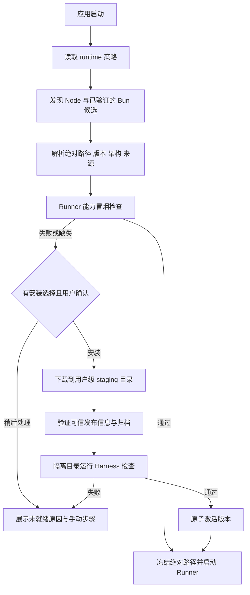

# Pi 官方安装脚本与 AgentChat 运行环境初始化

调研日期：2026-10-16。范围为官方 `install.sh` 与 `install.ps1` 静态阅读；未执行、source 或导入脚本，未安装运行时，未修改用户环境。Unix 行号对应 `/tmp/pi-install-analysis.sh` 快照（1853 行，SHA-256 `822e94298a79e61b5285fc559b7bfe89ac6ff64aac53d3dc9fc331a23d72e12e`）；PowerShell 对应 `/tmp/pi-install-analysis.ps1`（2054 行，SHA-256 `bc228f9c0584b86d917561690963e767aa1841233a04ab6208f62f28ee72c40f`）。在线脚本可能变化。文中 `S:`、`P:` 分别指上述脚本行号。

## 结论

Pi 安装器先复用当前命令解析到的 Node/npm；Node 低于 22.19.0 或缺 npm 才询问是否安装。Windows 默认安装用户目录下的 Node；macOS 有 Homebrew 时使用 Homebrew，Linux 仅在 apt/apk 仓库候选足够新时使用系统包管理器，其余使用 Node 官方 standalone 二进制。Pi 安装脚本完全没有 Bun 探测、安装或选择逻辑。[P:397–423、600–658；S:152–228、321–393]

需区分三个职责：Node/npm 是 Pi CLI 安装与运行时；Windows Git Bash 是可选的 Pi bash 工具环境；Pi managed installation 是 Pi 应用及其 npm 依赖的发布管理。第三项不等于托管 Node，更不要求 AgentChat 在线安装已随包的 Runner JS。[P:643–658、763–800、1381–1413、1534–1647]

## macOS/Linux Shell 脚本

### 检测及安装分流

Shell 通过当前 PATH 上的 `node --version` 检查版本是否至少 22.19.0，并检查 `npm` 命令。它只检查当前解析到的 Node，不遍历多个安装位置，也不验证 `node:sqlite` 或整个 Runner 契约。[S:152–178]

Node 或 npm 不满足时，安装分支要求交互终端确认；没有 `/dev/tty` 就停止并提示用户自行准备 Node/npm。平台选择逻辑如下：[S:180–228、236–359]

| 平台      | 选择规则                                                                      | 行为                                                                                                              |
| --------- | ----------------------------------------------------------------------------- | ----------------------------------------------------------------------------------------------------------------- |
| macOS     | PATH 中有 `brew` 就选 Homebrew，否则 standalone                               | 已装 Homebrew `node` 则 `brew upgrade node`，否则 `brew install node`。升级跟随 Homebrew 当前 Node，不固定 22.x。 |
| Linux     | apt 候选版本达到 22.19.0 则 apt；否则 apk 候选达到要求则 apk；否则 standalone | 用 apt/apk 安装 `nodejs`、npm，可能要求 sudo。                                                                    |
| 其他 Unix | standalone                                                                    | 只支持脚本映射的 OS/CPU 架构；不支持时退出。                                                                      |

Standalone 下载 `https://nodejs.org/dist/latest-v22.x/SHASUMS256.txt` 与匹配平台的 tar.xz。安装目录为 `${XDG_DATA_HOME}/pi-node` 或 `~/.local/share/pi-node`，其中保存版本目录及 `current` 符号链接。版本来自当时最新 22.x，不是固定版本。[S:362–393、431–471]

校验调用 `sha256sum` 或 `shasum -a 256`。如果两者都不存在，函数没有失败分支，会继续解包，因此校验不是所有环境下强制执行。哈希清单与归档来自同一 HTTPS 发行站点，不是独立签名验证。[S:395–407]

### PATH 与失败边界

安装器只把 standalone Node 的 bin 前置到当前脚本进程 PATH，不修改 shell profile；Pi managed launcher 启动时若检测到该私有 Node，也会将其 bin 前置到 Pi 进程 PATH。因此首次探测复用了系统 Node，并不意味着 Pi 之后仍使用系统 Node。[S:431–441、launcher]

Node 解压前会删除同名版本目录，激活时先删除旧 `current` 再创建链接；中断可能破坏已存在的版本或留下无效状态。脚本没有 staging 验证后原子切换这一层保护。[S:375–393]

## Windows PowerShell 脚本

### 检测与选择

`Invoke-PreflightChecks` 找当前 PowerShell 解析到的 `node`，执行 `node --version`，最低版本 22.19.0；另外只检查 `npm.cmd` 是否存在，不验证 npm 版本或 Node/npm 是否同源。[P:389–423]

缺少 Node、版本过低或 npm 缺失都会进入 Node 安装询问。默认安装，输入 `n/no` 可跳过；没有交互输入时不会自动安装，而是提示用户手动准备环境。安装后重新预检，仍不合格就退出。[P:643–658、1928–2008]

独立 Node 下载源为 `nodejs.org/dist/latest-v22.x`。脚本先取 SHASUMS256，再下载匹配架构的 Windows ZIP，必须找到清单项并通过 SHA-256 比对才解压。清单与文件同源 HTTPS，脚本没有校验清单签名或内置可信公钥，因此这不是独立发布者签名验证。[P:553–624]

安装到 `%LOCALAPPDATA%\\pi-node\\current`。它会改 HKCU 用户 PATH 和当前安装器进程 PATH；不改 Machine PATH。新开的终端会受到命令优先级变化影响，已运行终端通常需重开或刷新环境。后续 Pi launcher 通过 `node` 命令启动，不固定 Node 绝对路径。[P:478–502、504–551、1482–1505]

### 可选 Git Bash

Node/npm 预检完成后，脚本检查 Pi 的 `shellPath`、常见 Git Bash 路径及 PATH 上的 bash。找不到时可跳过，也可安装 PortableGit 到 `~/.pi/agent/win-git-bash` 并在 Pi settings 写入绝对 `shellPath`，或调用 winget 安装 Git for Windows。PortableGit 资产 SHA-256 会被强制校验，但脚本未另做 Authenticode 发布者校验。winget 命令没有指定 `--scope user` 或显式提权选项，实际安装范围取决于 winget manifest、安装器和权限。[P:689–916、2014–2028]

因此 Git Bash 不是 Pi CLI 安装的硬前提，却是其 bash 工具需要的可选环境。这个可选项应与 AgentChat Runner runtime 分开呈现。

## Pi 应用安装与 Node 初始化的边界

默认 managed 安装从 Pi installer API 获取 release metadata、`package.json` 和 `package-lock.json`，校验版本关系后执行 npm ci；再运行 Pi `--version` 验证，成功后发布到版本目录并切换 current。它管理的是 Pi 包及其依赖。[S:1381–1413、1534–1648；P:同等流程]

Pi 的 npm 项目最低 Node 版本是安装前提，不代表 AgentChat runtime 的充分能力条件。Pi 脚本也不要求 AgentChat 为已打包 `entry.js` 在线执行 npm install。

## AgentChat 当前启动边界

调研当时的 `RunnerProcess::spawn` 先定位 `entry.js`，再选择 Node：`AGENTCHAT_NODE` 覆盖；否则选资源目录随包 Node，再选开发目录 runtime；仅 debug 缺少随包 Node 时回退命令 `node`，release 缺失则报错。这是历史状态，源码已按后续决策改变。

截至 2026-10-16 后续更新，Rust 原生 resolver 检测 `AGENTCHAT_NODE`、PATH、常见系统目录及 AgentChat 私有 runtime 的 Node 24+，并检查 `node:sqlite`、版本、架构与绝对路径。首次启动先使用 Homebrew/winget/apt；失败或候选不合格时依次尝试 Node 官方发行源和 npmmirror，将归档回退安装到 AgentChat 数据目录，不修改 PATH。构建包只带 Runner `entry.js`。Windows 命名管道拒绝远程连接并受当前所有者、SYSTEM 与管理员 ACL 限制；`host.rs` 生命周期分支与 `host/windows.rs` 已通过隔离 Tokio harness 的 Windows GNU 目标编译，但完整 Tauri 应用交叉编译受缺少 MinGW 阻塞，Windows 运行仍未验证。[runtime.rs](../../src-tauri/src/runtime.rs)

当前查找会检查稳定版本与 `node:sqlite`；完整 Runner initialize 由初始化页启动 Runner 时验证。Bun 不属于自动检测或安装范围。

## AgentChat 初始初始化建议（已由后续实现决策取代）

> 以下流程图与条目记录调研初期的建议，涉及 Bun 选择、安装前二次确认、独立签名 manifest 等内容不代表当前产品行为。当前实现以本节前的“AgentChat 当前启动边界”和 [各平台 Node 方案](agentchat-runtime-platform-plan.md) 为准。

1. **明确候选排序。** 将系统 Node、可验证的 Bun 和随包 Node 作为不同来源。可设置系统优先、随包优先或仅随包；无论顺序如何，都解析真实绝对路径并验证版本、架构和能力，不能只接受 PATH 第一个同名命令。
2. **先筛版本，再验证真实能力。** 使用独立临时数据目录做 `node:sqlite`、依赖加载、initialize/close 与 Harness 启动检查。Pi 的 22.19.0 只可作 Node 参考下限，不自动成为 Bun 兼容承诺，也不是 AgentChat 全部能力验收。
3. **缺失时提供受控用户级安装。** 默认只供 AgentChat 子进程使用，明确 runtime 类型、版本、来源、安装位置和磁盘占用；不写 shell profile、不改 Machine PATH。GUI 没有 TTY，不能直接照搬 Pi 的交互式 shell 安装流程。
4. **固定发布信息并建立可信根。** 固定支持版本和平台资产。HTTPS 与同源哈希能发现传输或文件不一致，不能抵御发行源与哈希一起被替换。应使用签名 manifest、受签名的应用发布清单或等效信任链。
5. **Staging、验证、原子切换。** 下载解包到版本化 staging；运行冒烟检查；成功后原子切换 `current`。失败保留旧版，回收临时目录与子进程；安装并发需互斥。
6. **运行期间固定 runtime。** 每次 Runner spawn 使用冻结的可执行文件绝对路径，并准备适当子进程 PATH。安装升级先正常关闭 Runner，再切换，避免活动进程的环境漂移。
7. **Bun 单独设兼容门槛。** 只有 `node:sqlite`、`pi-durable`、工具子进程、取消/关闭与恢复契约在目标平台完成验证后才列为可选 runtime。Pi 安装脚本没有 Bun 方面的证据。

## 待定产品决策

- 首发是否支持 Bun；若支持，列出兼容版本及各平台验证矩阵。
- 多个 Node/Bun 候选、旧版本、过新版本、符号链接、Rosetta/转译与显式用户选择的优先级。
- 用户级 runtime 的自动更新、旧版本保留与卸载策略，以及代理、离线镜像和企业网络支持。
- UI 是否默认尝试下载，还是先展示计划并由用户点击安装；是否提供随包 Node 作为始终可用的最终兜底。

## 脚本额外初始化或修改的环境内容

除了 Node/npm 与 Pi 包本身，两份脚本还会准备以下内容。需区分“默认执行”与“仅在缺少依赖/命令时才执行”的分支。

### 两个平台共有

- **Pi 程序本体及更新布局**：默认写入用户的 Pi agent 目录下 `install/`，以 `releases/<version>/` 保存独立版本，使用 `current-version`、`managed-install.json`、启动器和 `pi` 命令链接选择当前版本。npm `ci` 把锁定的 Pi 依赖安装在 release 的 `node_modules` 下；正常安装忽略依赖 lifecycle scripts，并检查 staged Pi 的 `--version` 后才激活。不是把 Pi 当作 Node runtime 装进系统目录。
- **Pi 命令 PATH**：安装器选择可用且不覆盖其他 `pi` 的命令目录。缺少入口时建立启动器或符号链接；若该目录不在 PATH，会询问是否修改 shell profile，或提供手动 PATH 命令。profile 目标按 shell 选择 Fish `~/.config/fish/config.fish`、Zsh `$ZDOTDIR/.zshrc`、Bash `~/.bashrc`（没有时 `~/.profile`），其他 Shell 用 `~/.profile`。未检测到 TTY 时不会静默写 profile。
- **Node 自身的默认位置**：若 Node/npm 本来可用则复用；否则依平台安装 Homebrew/apt/apk Node 或下载独立 Node。Unix standalone Node 位于 `${XDG_DATA_HOME:-$HOME/.local/share}/pi-node/`，Windows 位于 `%LOCALAPPDATA%\\pi-node\\current`。这与 Pi 应用安装目录分开。
- **临时下载与 npm cache**：Node/Pi 下载过程使用系统临时目录；Pi managed 依赖通过 npm 安装，未显式重定向 npm cache，因此遵循当前 npm 配置及其默认缓存位置。脚本不专门安装 npm 全局工具集或设置私有 npm registry。
- **可选启动 Pi**：成功后脚本可提示立即以完整路径启动 `pi`，避免当前 shell 尚未刷新 PATH 导致找不到命令。

### Unix (`install.sh`) 特有

- 若已选 standalone Node，只对安装器当前进程及 Pi launcher 的子进程 PATH 前置私有 Node，不自动写 Node PATH 到 shell profile。profile 询问主要用于 Pi 自己的 `pi` launcher 目录。
- Linux standalone 解包时缺少 `xz`，脚本可能使用 apt/apk 和 sudo 安装 `xz-utils`/`xz`。所以即使 Node 最终装在用户数据目录，缺少解包工具仍可能触发系统软件包变更及提权。
- Homebrew 路线会对已有 `node` 执行 `brew upgrade node`，否则 `brew install node`；apt/apk 路线更新软件包索引并安装 `nodejs npm`。这些是全局系统环境变更。
- 可用 `PI_LEGACY_INSTALL=1` 切换旧式 npm 全局安装 Pi；若 npm 全局 prefix 不可写，会尝试用户级 `.local` prefix，并提示加 PATH。默认 managed 安装不走这条路。

### Windows (`install.ps1`) 特有

- standalone Node 安装将 `%LOCALAPPDATA%\\pi-node\\current` 写入 **HKCU 用户 PATH**，并更新安装器当前 PowerShell 的 PATH；不改 Machine PATH。PowerShell 会广播环境变更，但已运行终端通常仍需刷新/重开。脚本安装的是 Node ZIP，不是 MSI 系统安装器。
- Git Bash 是可选的**工具环境**，不是 Pi CLI 安装必需条件。找不到 Bash 时，默认下载 PortableGit 到 `%USERPROFILE%\\.pi\\agent\\win-git-bash`；校验资产哈希，解包后把绝对 `bash.exe` 路径写进 `%USERPROFILE%\\.pi\\agent\\settings.json` 的 `shellPath`，保留同文件其他 JSON 设置。这个 managed PortableGit 分支不把 Git 整体加入 PATH。
- 另有可选 winget 路线：执行 `winget install --id Git.Git ...` 安装 Git for Windows；脚本没有固定 `--scope user`，也没有自行发起提权，实际范围/权限取决于 winget 与其安装器。

### 没有被这两份安装器初始化的项目

- 不安装 Python、Bash（Unix 默认假定系统工具存在）、Git（除 Windows 可选 Git Bash/Git for Windows）、编译器或其他项目运行时。
- 不自动登录模型服务、不设置 API key、不创建项目级 `AGENTS.md` 或工作区。
- 不运行 Pi 来完成首次配置；不会替用户配置 provider、模型或 MCP/Skill/Extension。
- `~/.pi/agent` 是 Pi 的配置/资源目录约定，安装器仅在需要时写安装标记/launcher，或 Windows 为了 `shellPath` 创建/更新 `settings.json`；这不代表整个 Pi 用户配置已完成初始化。

## 对 AgentChat 初始化的含义

若参考 Pi 的体验，应把初始化拆成几类并逐项说明副作用：Runner Node、可选工具 Shell/Git、Runner 应用文件、系统包管理器权限、Agent 配置/凭据。不要把 Pi CLI 安装脚本整段搬入：Pi 的 launcher、Pi release 目录、npm cache 与 `shellPath` 是 Pi 自身的产品级状态，不能自动视为 AgentChat 的环境依赖。AgentChat 已实现“复用 Node 24+；缺失时先包管理器安装，再用 Node 发行包私有回退”的策略，见 [AgentChat runtime 初始化建议](agentchat-runtime-initialization-proposal.md)。

这些建议不改变前文脚本事实；本文件仍为静态分析，没有执行 Pi 安装器或修改用户环境。
