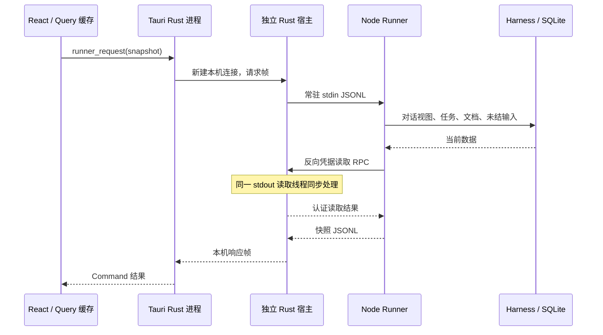

# Runner 与桌面通信性能研究

日期：2026-10-20。本文先记录基线调查与隔离基准，后续实施及复测结果见文末。范围：Agent/Bot 切换、对话查询、Node 与原生宿主通信。

## 结论与证据边界

**基线证实查询粒度与认证状态读取会放大等待，首批优化已落地并通过隔离复测。** 合成基准中的并发快照等待显著下降，Bot 列表改走批量摘要，聊天历史改为用户触发加载。尚未捕获真实桌面“点击到绘制”trace，因此不能断言用户停顿的全部根因已定位或桌面性能目标已达到。

以下五项是首批优化实施前的基线调查结果：

1. 列表摘要当时需要完整快照；所选 Bot 的历史时间线需要逐会话快照。每份快照最后检查认证状态，同一凭据来源的读取被串行化。合成慢凭据可把并发查询变成近似 `会话数 × 单次读取延迟` 的等待。
2. 每次本机请求新建 socket 和服务线程，Unix accept 循环空闲时休眠 10ms；这一层有可测量的固定额外成本。
3. 原生宿主在唯一 Node stdout 读取线程同步处理凭据请求。慢凭据期间，即使 Node 已生成其他响应，也必须等待读取线程继续分发。
4. 快照在无其他观察者时反复加载当前有效对话范围；只输出 50 条不限制上游读取量。但本次 1,000 条短消息数据下，这部分远小于注入的认证延迟。
5. Markdown、React commit 与布局仍需在真实 WebView 中测量。当前没有足够证据将停顿归因为前端渲染。

## 初始实现形态（优化前）

- [列表摘要](../../src/features/bots/use-bot-summaries.ts:25)：基线形态为 B 个有会话的 Bot，对应 B 个最新会话完整快照。
- [时间线](../../src/features/chat/use-bot-timeline.ts:9)：基线形态为所选 Bot 有 H 个会话，对 H 个键建立查询。冷启动且查询重叠时，列表与时间线最多涉及 B+H−1 个不同快照键；这是键的数量，不保证每次切换都请求这么多次。
- [缓存与轮询](../../src/app/runner-queries.ts:66)：基线 staleTime 为 10 秒，当前会话每 1.2 秒轮询，无执行任务时仍轮询。同键共享缓存及进行中的请求；新鲜缓存切回不要求再走完整链路，缓存过期也不要求先清空已缓存数据。

## 实际链路



入口为 [runner-client](../../src/app/runner-client.ts:127)、[Command](../../src-tauri/src/commands/mod.rs:18)、[本机宿主](../../src-tauri/src/host.rs:548) 与 [Node 传输](../../src-tauri/src/runner/transport.rs:121)。Command 已使用阻塞任务池，不能仅凭阻塞 socket API 断言它冻结 Tauri 主线程。

- 同时轮询、摘要、详情读取同一会话不能直接算作三份请求。[TanStack Query 文档](https://github.com/tanstack/query/blob/main/docs/framework/react/guides/polling.md)确认轮询独立于 staleTime，进行中请求按查询键去重。

## 隔离基准与复现方法

[Node 基准脚本](../../runner/scripts/benchmark-queries.ts)创建独立临时目录、20 个 Bot、39 个会话。其中首个 Bot 有 20 个会话，最新会话放入 1,000 条 Entry，第二个 Bot 放入 50 条，每条约 500 字符。通过公开 Session API 写入被动 Entry，不提交模型输入。所有模型配置均使用已安装目录，认证适配器只返回合成数据。

[Rust 基准示例](../../src-tauri/examples/benchmark-ipc.rs)直接编译引用现有 host 与 runner 传输模块，只替换 runtime 定位和 credentials 实现；因此覆盖实际 Unix socket、线程、JSON 帧、Node 子进程及反向 RPC。它不是 Tauri WebView 测试。未新增依赖，未启动桌面窗口，未读取真实聊天或系统凭据。

从仓库根运行，要求符合项目要求的 Node 和已安装依赖：

```bash
bun build runner/scripts/benchmark-queries.ts --target=node --outfile=/tmp/agentchat-query-benchmark.mjs
node /tmp/agentchat-query-benchmark.mjs
```

加入 Rust 层：

```bash
cargo build --manifest-path src-tauri/Cargo.toml --example benchmark-ipc --offline
BENCH_NATIVE="$PWD/src-tauri/target/debug/examples/benchmark-ipc" node /tmp/agentchat-query-benchmark.mjs
```

只重测 Rust：

```bash
BENCH_NATIVE="$PWD/src-tauri/target/debug/examples/benchmark-ipc" node /tmp/agentchat-query-benchmark.mjs --native-only
```

数秒内复现查询预算超限：

```bash
node /tmp/agentchat-query-benchmark.mjs --assert-query-budget
```

预算模式每项预热 3 次、测量 3 次，要求注入 15ms 认证读取的 20 份快照查询 p95 ≤200ms。当前应失败，初次实测输出 `20 snapshots p95 350.83ms > 200ms; single 16.49ms`，退出码 1。这捕获真实快照调用与凭据串行化的组合，不是桌面绘制断言；200ms 为研究预算，未纳入普通单测。

常规基准每项预热 3 次、测量 30 次，p50/p95 使用排序后的 nearest-rank。输出仅含耗时、结果序列化字节数、读取次数；批量耗时指整批完成，UI 当前实现可逐会话展示，不需要等待整批完成。结果字节数不含协议包装，直接调用计时也不含最后用于统计字节数的序列化；JSONL 和 Rust 链路计时包含实际传输的编码/解码。

环境：macOS arm64，Node v26.12.0，pi-durable/pi-ai 1.3.0；Rust 为 debug 构建。不是 release 性能承诺，30 个样本只用于此次分层比较。

## 测量结果

单位：毫秒。认证列为每次合成凭据读取的注入延迟；Rust 还使用真实反向 RPC，但不访问系统凭据。

| 链路与查询                                 | 认证延迟 |    p50 |    p95 | 每批凭据读取 |
| ------------------------------------------ | -------: | -----: | -----: | -----------: |
| Runner 直接调用，空会话                    |        0 |   0.10 |   0.17 |            1 |
| Runner 直接调用，50 Entry                  |        0 |   0.34 |   0.49 |            1 |
| Runner 直接调用，1,000 Entry               |        0 |   1.25 |   1.55 |            1 |
| Runner 直接调用，20 Bot 摘要所需快照       |        0 |   2.48 |   2.81 |           20 |
| Runner 直接调用，20 历史会话快照           |        0 |   2.08 |   2.48 |           20 |
| Runner 直接调用，空会话                    |       15 |  16.42 |  16.91 |            1 |
| Runner 直接调用，50 Entry                  |       15 |  17.73 |  18.50 |            1 |
| Runner 直接调用，1,000 Entry               |       15 |  20.00 |  21.02 |            1 |
| Runner 直接调用，20 Bot 摘要所需快照       |       15 | 326.48 | 334.08 |           20 |
| Runner 直接调用，20 历史会话快照           |       15 | 325.68 | 330.88 |           20 |
| Node JSONL，空会话                         |        0 |   0.17 |   0.31 |            — |
| Node JSONL，1,000 Entry                    |        0 |   1.34 |   1.77 |            — |
| Node JSONL，20 Bot 摘要所需快照            |        0 |   2.95 |   3.42 |            — |
| Node JSONL，空会话                         |       15 |  16.64 |  17.46 |            — |
| Node JSONL，1,000 Entry                    |       15 |  19.98 |  20.81 |            — |
| Node JSONL，20 Bot 摘要所需快照            |       15 | 326.22 | 331.43 |            — |
| Rust 本机 IPC + JSONL，空会话              |        0 |  12.08 |  14.06 |            — |
| Rust 本机 IPC + JSONL，1,000 Entry         |        0 |  11.61 |  23.26 |            — |
| Rust 本机 IPC + JSONL，20 Bot 摘要所需快照 |        0 |  16.64 |  28.40 |            — |
| Rust 本机 IPC + JSONL，空会话              |       15 |  24.05 |  31.77 |            — |
| Rust 本机 IPC + JSONL，1,000 Entry         |       15 |  33.07 |  38.09 |            — |
| Rust 本机 IPC + JSONL，20 Bot 摘要所需快照 |       15 | 369.75 | 397.53 |            — |

独立响应阻塞探针：每次发起空会话快照，20ms 后发起无认证需求的配置读取，仅计算配置请求自身等待时间，最后等待两个请求结束再开始下一次采样。

| 配置读取场景                     |   p50 |   p95 |
| -------------------------------- | ----: | ----: |
| 认证适配器延迟 0ms，无并发认证   | 12.25 | 12.89 |
| 认证适配器延迟 15ms，无并发认证  | 11.68 | 13.05 |
| 认证适配器延迟 100ms，无并发认证 | 12.00 | 13.17 |
| 与 100ms 凭据读取重叠            | 84.26 | 93.92 |

直接调用的空快照为 769 字节；50 Entry 的投影为 29,508 字节，1,000 Entry 为 29,617 字节，20 Bot 的快照合计 72,998 字节，20 历史会话合计 44,235 字节。这组数据正文较短，不能外推到长工具输出或复杂 Markdown。

实测支持以下判断：

- 当前同源认证等待可以使 20 个并发查询累积约 300ms；直接 Node 与 JSONL 都能复现，重写前端到 Node 的通道无法自动消除它。
- 本机 IPC 的额外成本在此环境下约为十余毫秒，与非阻塞 accept 的休眠机制相符。不同独立进程、调度和样本下不能将两个 p95 的差当成精确阶段耗时；要精确归因还需同请求分段采集。
- 慢原生凭据会拖延不需要凭据的响应，已有交叉请求实测。示例中的 readConfiguration 在 Node 侧不经过 checkAuth。
- 1,000 条无 reset/fork 的有效消息增加了读取成本，但此数据下本身未产生数百毫秒停顿。不能将“存在全范围读取”直接等同于“它是当前首要瓶颈”。
- 批量总耗时不是首屏耗时；当前会话若位于同来源认证队列后部可能受到等待，但具体排位、缓存命中和首屏渲染需要桌面 trace 确认。

## 源码解释与可用优化接口

### 查询与认证

[快照实现](../../runner/src/harness/views.ts:20)依次获得 conversation、viewState、taskGraph、元数据、目标、agent、配置缺失检查和 inspection，最后等待 `isConfigured`。该回调在 [Runner 装配](../../runner/src/harness/open.ts:152)调用 `models.checkAuth`；[凭据串行器](../../runner/src/providers/runtime.ts:133)按 NativeAdapter 与凭据来源串行执行读取，[读取入口](../../runner/src/providers/runtime.ts:175)每次调用 native adapter。

因此提高快照并发数不能消除同来源的认证等待。移除这条展示请求上的重复检查，比单纯把若干 `await` 改成 `Promise.all` 更有针对性。不同来源的凭据锁可独立，但当前 Rust 单读取线程仍会同步执行反向 RPC。

### 有效对话范围、任务与输入

[消息投影](../../runner/src/harness/messages.ts:13)在取到 entries 后才截取末 50 条；每条 2,000 字符的截断也发生在内容合并和字符数组创建之后。

已核对实际安装 pi-durable 1.3.0 源码，以下路径均为其公开包内实现：

| 调用                     | 无其他观察者时的成本                                                                | 已有持续观察者时                           |
| ------------------------ | ----------------------------------------------------------------------------------- | ------------------------------------------ |
| `conversation.viewState` | 按页加载完整 active transcript、内建文档；受最新 head 和 fork 可见范围限制          | 共享 mount，并从 commit 更新               |
| `harness.taskGraph`      | 全局扫描 pending/running/waiting/completing tasks，逐任务读取其拥有的 conversations | 共享 mount，并增量维护                     |
| `harness.inspect`        | 遍历全局 live task 内存集合、必要时补 owner 链；全局查询 queued/placed submissions  | submissions 仍需读取，不直接复用 taskGraph |

当前快照每次 [dispose 两个 state](../../runner/src/harness/views.ts:72)，最后观察者离开后上游会移除 mount。精确证据位置：包内 `harness/view.js:87–120`、`harness/context.js:188–212`、`harness/task-graph.js:57–87`、`harness/harness.js:159–165`、`harness/scheduler.js:1163–1185`。这些实现结论需要随上游版本升级重核。

公开 `Conversation.entries`、`watch`、`watchTaskGraph` 和 `Storage.scanTasks/scanSubmissions` 足以支持进一步优化；[Runner 已持有 Storage](../../runner/src/harness/open.ts:139)，不必引用库私有成员。具体限制：

- 持续观察可以避免反复初始化，但首次仍需加载有效范围，watch 也不是历史分页。只为活跃/近期会话保留观察者，配置数量上限和空闲释放，并在 Runner close 时 dispose/stop。
- 历史分页不能简单用“最新 51 条 raw Entry”替代 active transcript；必须保留 head、reset、fork、顺序和 hasMore 语义。
- 按会话查询任务和未结输入可减少全局匹配行读取，但已有索引不等于任意组合恒定成本，必要时用合成库 EXPLAIN 测量。全局匹配行读取不能称为物理全表扫描。
- 没有覆盖全部 submissions 的现成 Conversation watch；若使用 commit 订阅维护投影，需要处理初始化竞态、重连和替换帧。
- 当前各次读取也不构成一个跨全部数据的原子快照；任何增量契约都需要单独定义版本与一致性。

### 原生传输

[宿主发送](../../src-tauri/src/host.rs:548)每次 connect，[接收循环](../../src-tauri/src/host.rs:575)新建工作线程，空闲时 sleep 10ms。[响应读取](../../src-tauri/src/runner/transport.rs:340)同步执行反向凭据操作，完成后才读下一帧。这是连接调度成本与响应分发阻塞两个独立问题，应分别验证。

### 前端渲染

[聊天视图](../../src/features/chat/chat-view.tsx:65)收集所有会话消息文本，并创建所有消息行；[MessageBody](../../src/features/chat/message-content.tsx:20)包括用户行都会调用 [Markdown 插件 hook](../../src/features/chat/use-markdown-plugins.ts)。每次 hook 执行会扫描同一份 texts 检测 Mermaid。若 N 行实际重渲染、文本总长 S，则存在约 O(N×S) 的重复扫描机会，但 React Compiler 是否跳过执行必须实测。

[滚动组件](../../src/components/ui/message-scroller.tsx:64)已有 `content-visibility:auto`，不等价于 React/Markdown 列表虚拟化。[入场动画](../../src/features/chat/use-message-entrance.ts:12)明确避免切换时重播历史，不能把它当成已知卡顿原因。

## 推荐实施顺序与契约草案

首批前三项已实施；原生响应分发与 accept 调度仍是后续优化候选。以下接口草案中的 botSummaries 已落地；消息分页与独立会话状态接口仍未实施。

| 顺序   | 范围                             | 预期改变                           | 复杂度与验证重点                                 |
| ------ | -------------------------------- | ---------------------------------- | ------------------------------------------------ |
| 已完成 | 认证状态脱离每次正文快照         | 同源多会话展示不再重复等待凭据读取 | 已加 revision/TTL 缓存及 Runner 回归测试         |
| 已完成 | 轻量批量 Bot 摘要                | B 份完整消息快照变为一次摘要请求   | Node JSONL 契约与旧 Runner 明确 unsupported 回退 |
| 已完成 | 当前会话优先，历史按需加载       | 进入聊天不主动拉取全部历史会话正文 | 已覆盖当前会话优先和显式加载历史                 |
| P1     | 原生凭据有界异步处理             | 慢凭据不阻塞 stdout 响应分发       | 中；每来源写入顺序、背压、停止时任务收尾         |
| P1     | 就绪驱动的 accept                | 去除空闲 10ms 轮询等待             | 中；停止唤醒、实例锁与平台差异                   |
| P1     | 有界复用 view/graph 或按会话读取 | 降低长对话重复初始化及全局工作量   | 中；生命周期、内存上限、并发初始化与失效         |
| 待测   | Markdown 共享扫描、窗口化渲染    | 减少真实发生的扫描、解析和布局工作 | 先 profiler；不能仅凭源码决定重构                |
| 后续   | 增量变更订阅、常驻本机连接       | 降低空闲轮询及重复完整载荷         | 较高；游标、重连补齐、背压、取消与版本兼容       |

具体接口可以沿用当前 Command 和 RunnerRequest 边界：

- `botSummaries`：一次返回每个 Bot 的最新会话 ID、短摘要和执行状态。摘要选择规则与现有列表保持一致，不能误把“最新 user/assistant”替代当前“最新非空文本”而无产品确认。只扫描需要的尾部记录或复用有界投影，不调用完整 snapshot；认证状态不属于每个摘要。
- `conversationMessages({conversationId, cursor?, limit})`：返回当前有效范围内的消息页、下一游标与 hasMore。游标绑定会话、范围和顺序，限制页大小；在 head/reset 变化后拒绝或重置过期游标。库游标由后端拥有，不解析内部字段。分页前先锁定现有展示语义，另外讨论是否展示旧 active range 外历史。
- `conversationStatus({conversationId})`：承载任务、未结输入及必要运行状态；静态 Agent 配置和认证状态按自身失效规则读取。Query 键分别表达摘要、消息页、状态，变更操作只失效受影响数据。

`botSummaries` 已新增 Rust/Node 双侧 typed request、能力字段与回归测试；其他新操作仍需双侧输入验证、稳定返回类型、拒绝与异常测试。旧 Runner 只在明确的“不支持的 Runner 操作”错误下回退，权限错误、数据错误及其他失败继续向用户暴露。

认证展示可以缓存状态（不缓存额外明文凭据）：应用内凭据写入/删除成功、配置重载与 Runner 重启立即失效；外部凭据/环境来源变更采用有界 TTL 和手动刷新。实际提交仍调用认证校验，不能由展示缓存授权发送。缓存过期继续显示已知状态并后台验证，避免短暂误报“未配置”。

轮询先按活跃状态调整：执行/有排队输入时维持短间隔；空闲状态降低频率，并在提交及其他相关 mutation 后立即刷新。其他客户端可发起执行，因此在没有变更订阅前不能永久停止空闲检查。推送如采用 Channel，应携带会话与版本、支持完整替换和重连补齐；Tauri Channel 只解决其中一段，不自动解决后台宿主与 Node 的订阅。

## 后续桌面验收与尚未完成项

真正的停顿定位仍需在生产构建 WebView 记录：点击 → 路由/选中状态 → 快照请求开始/返回 → React commit → 浏览器绘制及滚动稳定。每层使用自身单调时钟计算耗时，通过请求 ID 关联，不直接相减跨进程时间戳。

覆盖冷切换、A→B→A 新鲜缓存切回、10 秒后切回、多会话、长代码/Mermaid、模拟执行与排队输入、Runner 重启。相同响应下比较纯文本与富文本，分开记录首批内容可见和完整历史完成。

暂定目标：缓存切回首批消息 p95 ≤100ms；受控本地冷切换首批消息 p95 ≤200ms。这些是实施验收目标，本研究没有证明达到。缓存切回必须展示目标 Bot 自身数据，后台刷新不清空正文，快切不串会话。

未覆盖：真实 WebView 的点击/绘制、真实系统凭据的延迟分布、活跃执行与排队规模的性能、reset/fork 分页等价性、release Rust、Windows named pipe。此次测得的 15/100ms 是注入延迟，不能写成 macOS Keychain 的实际性能。

本次验证：

- `vp check runner/scripts/benchmark-queries.ts`：格式、lint、类型检查通过。
- `bun run --cwd runner typecheck`：通过。
- `cargo build --manifest-path src-tauri/Cargo.toml --example benchmark-ipc --offline`：通过。
- `cargo clippy --manifest-path src-tauri/Cargo.toml --example benchmark-ipc --offline -- -D warnings`：通过。
- `cargo fmt --manifest-path src-tauri/Cargo.toml --check`：通过。
- `cargo test --manifest-path src-tauri/Cargo.toml --lib --offline`：20 项通过。
- Node/JSONL 与 Rust 完整基准：各场景 30 次采样，正常退出；临时数据与隔离宿主正常收尾。
- `--assert-query-budget`：按设计失败并退出 1，捕获未修复的认证查询放大。
- `git diff --check`：通过。新增文件另由上述格式检查覆盖，文档相对链接按仓库位置核对。

初始调查时未运行前端构建、前端 UI 测试与 Tauri 桌面冒烟：当时只新增研究脚本与 Rust example。后续优化验证见下文；没有 CI 结果。本研究不创建提交、不推送。

## 后续优化实现与复测（2026-10-20）

研究完成后开始落地第一批优化：新增 `botSummaries` 批量操作和能力声明；Runner 列表摘要不再要求客户端对每个 Bot 读取完整快照。快照认证展示按供应商合并并发读取，设置 30 秒 TTL，并在 Runner 内凭据、凭据目录和配置变化后失效。快照消息投影改为从公开 Storage 接口读取 active head 到最新 entry 范围内的最多 51 条记录，再保留原有末尾 50 条投影语义。

新增测试覆盖并发认证去重与失效竞态、摘要中不泄露凭据、超长消息有界读取、空/50 条/head/reset/fork 与完整公共视图等价、真实 Node JSONL 请求和执行中摘要。Runner 全量测试 **62 项通过**；根目录 `vp check` 无格式、lint 或类型错误。Rust IPC 契约测试 **22 项通过**，并通过 offline check、clippy 和 fmt。尚未进行真实桌面应用/WebView 冒烟。

相同隔离基准脚本现以 Bun 内建 Node **v26.3.0**、macOS arm64、每场景 30 次采样运行。带 15ms 合成认证读取的 20 会话并发快照，p95 从相同场景基线的 **336.10ms** 降到 **2.64ms**；计时阶段凭据读取数为 **0**（TTL 缓存已在预热阶段建立）。Node JSONL 对应场景 p95 **2.68ms**。有 1,000 条被动消息的单快照 p95 **0.93ms**。这些是快照扇出和有界读取的隔离测量，不是新 `botSummaries` 操作的单独基准；合成延迟不代表系统钥匙串测量，也不等于真实 WebView 点击到绘制延迟。

前端已完成批量摘要查询：声明支持的 Runner 走单次摘要请求；未声明能力的旧 Runner 按 Bot 使用共享快照缓存独立加载，避免一个慢快照阻塞整个列表；已声明但返回明确 unsupported 的 Runner 才从批量查询回退快照。聊天时间线优先加载当前会话，较早会话由用户显式触发。新增摘要回退测试 4 项通过；选中会话优先与历史显式加载回归通过；`vpr check`、`vpr build` 通过（存在大 chunk 警告）。完整 `tests/ui/submission.test.ts` 有 30/32 通过，另外 2 项设置分类切换测试失败；未证明这两项是否为基线失败。Runner 全量测试 62 项通过，Rust IPC 单元测试 22 项通过；Rust offline check 与 Clippy 通过。仍未进行真实 Tauri/WebView 冒烟。桌面停顿是否达到目标，需在真实 WebView 记录点击、Runner 请求、React commit 与浏览器绘制时间；不能仅由 Runner/JSONL 基准推断。
